# MYTHOS — 神话星图

A deep-space, multi-file web atlas of the world's mythologies and religious traditions. 一个以深空星海为底色的世界神话多文件网页集。

## 简介 / About

- **19 traditions** across five continents + Christian scripture narrative.
- **229 figures**, each with a full dossier page and a public-domain artwork (sourced & credited, see `assets/`).
- **114 stories**, **133 study chapters** (a 7-layer curriculum per tradition).
- **502 static HTML** pages, fully offline.
- 3 languages: 简体中文 / 繁體中文 / English.

## 使用 / Usage

Just open `index.html`. No build step, no server, no network needed.

| Page | Path |
|---|---|
| Home | `index.html` |
| Figure archive | `figures.html` |
| Study map | `learning.html` |
| Stories | `stories.html` |

Each tradition lives in `worlds/<id>.html`; each figure in `figures/<id>.html`.

## 图片 / Artwork

`assets/art/<id>.jpg` — public-domain works downloaded from Wikimedia Commons. Every image carries a credit (artist, date, license, source page) rendered on the page. A small number of figures without surviving portraits use a related public-domain artifact, clearly labeled as such.

## License

Code & pages: **MIT**.
Artwork: public domain, individual attribution in-page.
